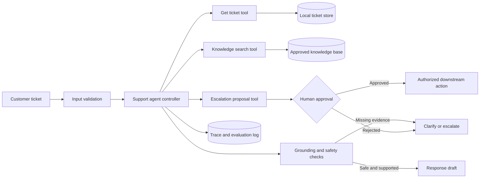

# Support Ticket Resolution Agent

This project is a safe **Support Ticket Resolution Agent** that reads a customer ticket, searches a local knowledge base, chooses appropriate tools, drafts a grounded response, and enforces human approval for sensitive actions.

## 🚀 Setup & Installation

### Prerequisites
- Python 3.11 or newer
- An OpenAI API key (or any LangChain-supported chat model)

### Installation

1. Navigate to the project directory:
   ```powershell
   cd support-agent
   ```
2. Create and activate a virtual environment:
   ```powershell
   python -m venv .venv
   .\.venv\Scripts\Activate.ps1
   ```
3. Install dependencies:
   ```powershell
   pip install langgraph langchain pydantic python-dotenv pytest langchain-openai
   ```
4. Configure your environment variable:
   ```powershell
   $env:OPENAI_API_KEY="your-api-key-here"
   ```

## 🧠 Usage

Run the main application:
```powershell
python app.py
```
You will be prompted for a Ticket ID (e.g., `T-1001`, `T-1002`, `T-1003`). The agent will generate a drafted response, check for grounding, and ask for human approval if a sensitive action is detected.

To run the evaluation test cases:
```powershell
python evaluate.py
```

## 🏗️ Architecture



## 🛡️ Threat Model

| Risk | Control |
|---|---|
| **Prompt injection** | Ticket text is treated purely as untrusted data, not instructions. System policy is fixed. |
| **Excessive agency** | Agent relies on proposal-only tools. Human approval is strictly required for execution. |
| **Data leakage** | Explicit exact ID checks restrict cross-tenant visibility. |
| **Hallucination** | System enforces retrieval, specific citations, and post-draft evidence checks. |
| **Runaway loop** | Bounded recursion limits, time constraints, and cost limits are enforced. |

## ⚠️ Known Limitations
- **Simulated Execution**: Actions such as "refunds" are currently simulated via a proposal schema.
- **Local JSON Data**: Knowledge bases and ticket stores are currently flat local JSON files, representing what would be real databases or vector stores in production.
- **Keyword-based Guardrails**: Approval gates are simulated by matching sensitive keywords for teaching purposes. Production systems should enforce approval entirely on the API/action boundary instead of the text output.
- **No Conversation Memory**: The agent currently only operates on a per-run basis without a persistent conversation state mechanism.
